<h1 align="center">
    <a href="https://squadcalc.app">
      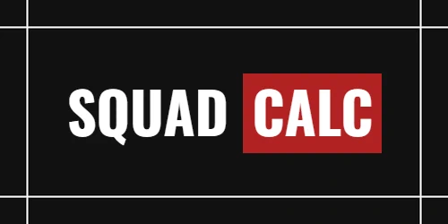
    </a>
</h1>

    
    
    
      

 
 

[SquadCalc.app](https://squadcalc.app/) – The Ultimate In-Game Companion for [Squad](https://joinsquad.com/)!

 
 
 
# <b>Screenshots</b>

    <picture>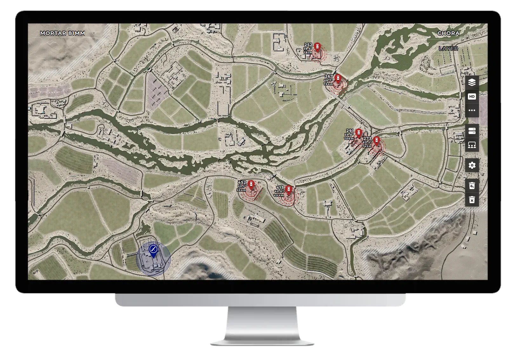</picture>  
    <picture>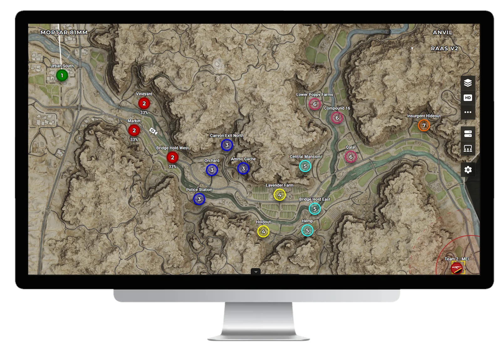</picture>
    <picture>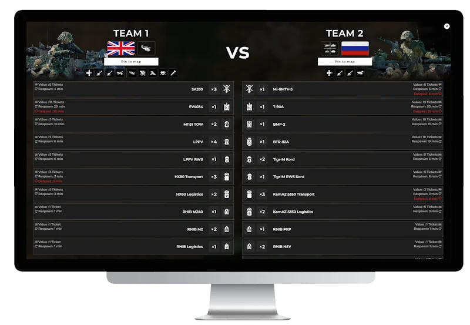</picture>
    <picture>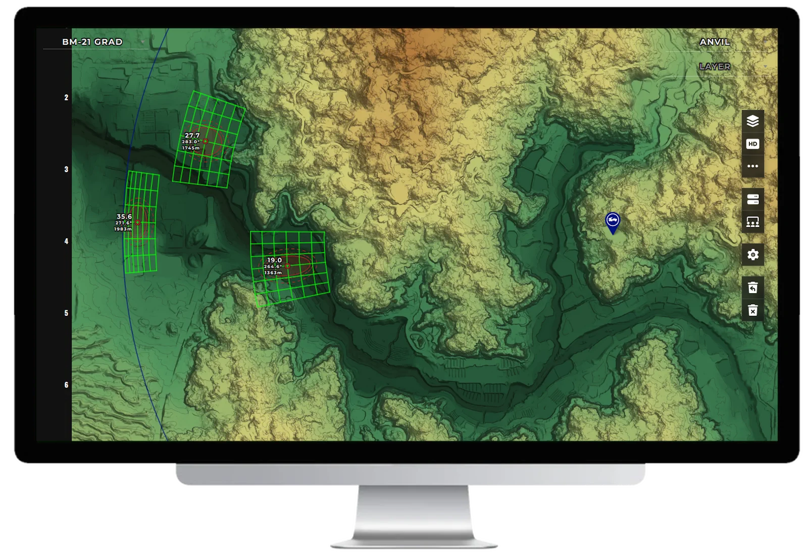</picture>
    <picture>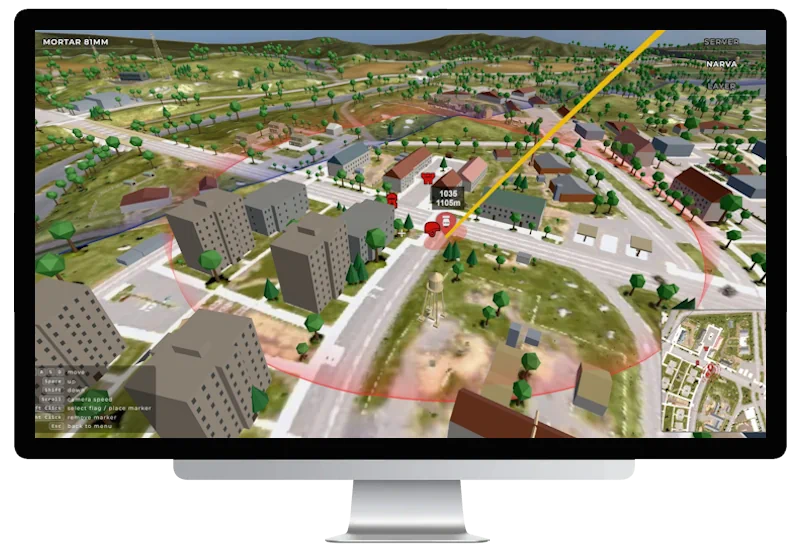</picture>

 

# <b>Features</b>

## Mortar Calculator

  
<b>Elevation Calculations</b>

   
  SquadCalc utilizes heightmaps extracted from the Squad SDK to precisely compute the elevation difference between mortars and targets, automatically adjusting the elevation settings.  
  
   

  [Check out the Wiki](https://github.com/sh4rkman/SquadCalc/wiki/Deducing-Altitude) to understand how it works.

   

  
<b>Spread and Damages radiuses</b>
  
   
  Reduce teamkilling and maximize your damage by visualizing the spread of your shells and the range of their explosions.  

  Check out the Wiki on [Spread](https://github.com/sh4rkman/SquadCalc/wiki/Deducing-Spread) and [Damage](https://github.com/sh4rkman/SquadCalc/wiki/Deducing-Damage-Radius) to understand how it works.

  

    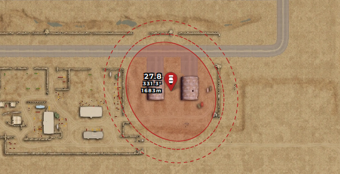
  

   

  
<b>Commonly used spots</b>

   
  SquadCalc logs up to 15000 weapon positions for each map and each weapon, creating a dynamic heatmap of where other players commonly set up their weapons. If you're having trouble finding a good spot to place your mortar or weapon, enable the 'Frequent Locations' feature!  

   
  

    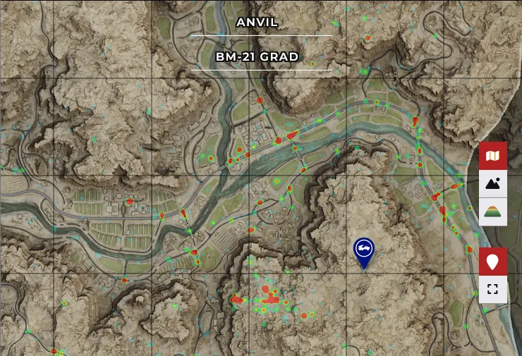
  

   

  
<b>Squad Mortar Overlay Compatibility</b>

     

  SquadCalc is compatible with [Squad Mortar Overlay](https://github.com/Devil4ngle/SquadMortarOverlay), made by [Devil4ngle](https://github.com/Devil4ngle).  
  Squad Mortar Overlay is a program that captures screenshots of your ingame map and overlays them with SquadCalc.  

  It allows:
  * Having ingame markers automatically merged into SquadCalc map to quickly place the right targets
  * Having an ingame overlay with the current SquadCalc calculations displayed in front of Squad

   

  ### 
[> Download Squad Mortar Overlay <](https://github.com/Devil4ngle/SquadMortarOverlay/releases)

 

## Layer Info

  
<b>Lanes/Flags preview</b>

   

  Hover over a flag to preview how selecting it would affect the layer.  
  This allows you to quickly scan how the layer looks at the start of the game, for example.

  

    <picture>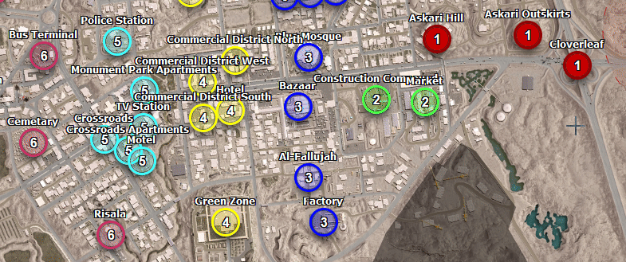</picture>
  
 

  
<b>Capzones</b>

   

  SquadCalc lets you see each precise flag capzone extracted from the game SDK and view it in detail.  
  It helps you find the perfect location for a FOB, the best route to sneak into a cap zone, or even where to fire mortars effectively.

  

    <picture>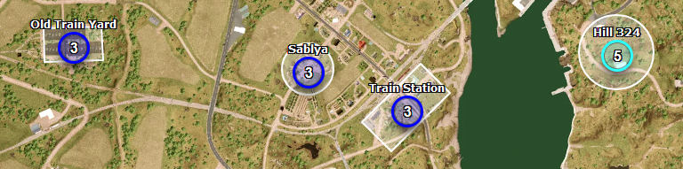</picture>
  
 

  
<b>Main Protection & No-deploy zone</b>

   

  Plan your radios and mortars: SquadCalc displays every main protection zone (no vehicle shooting) and no-deploy zone (radios, mortars, emplacements).

  

    <picture>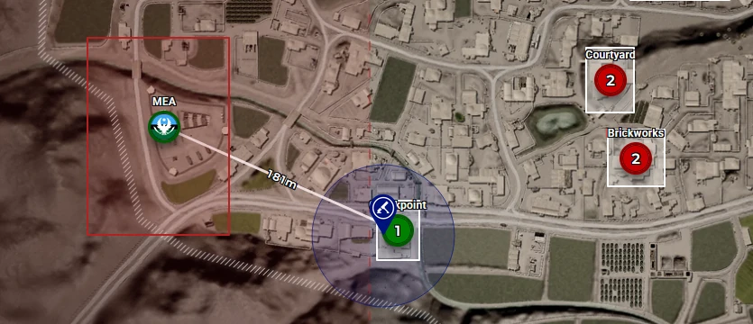</picture>
  
 

  
<b>Real map borders</b>

     

  Each layer can have its own playable area: SquadCalc shows the exact invisible map limits.  

  

    <picture>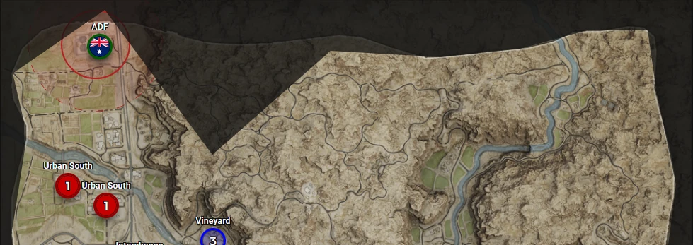</picture>
  
 

  
<b>Autocomplete</b>

     

  SquadCalc will automatically complete the layer if there is only one possible incoming flag, saving you a few clicks.

  
<b>Factions, Units and Vehicles list</b>

     

  Browse every available faction, unit and vehicle for each layer:

  

    <picture>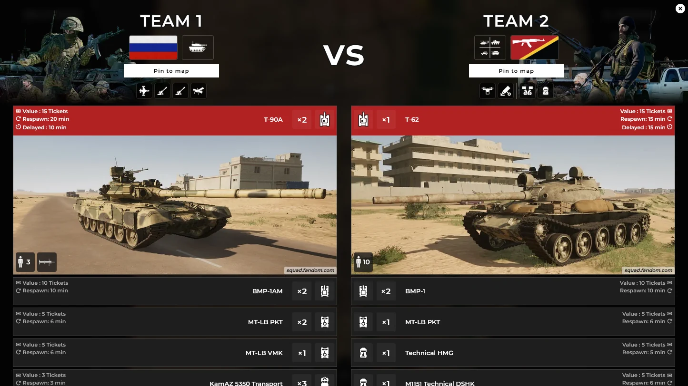</picture>
  
 

  You can also pin the enemy vehicles list to your map and set timers when you destroy them: you will receive a sound notification when they respawn !

  

    <picture>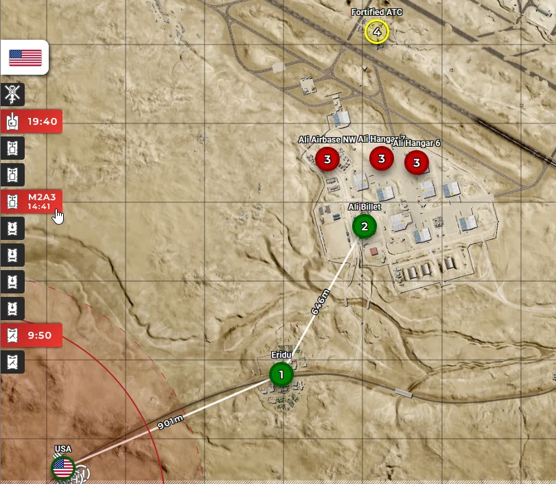</picture>
  
 

  Change faction and pick a unit directly from the map by right-clicking a main:

  

    <picture>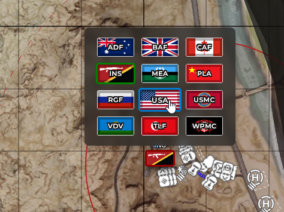</picture>
  
 

  
<b>Vehicles Spawns Locations</b>

     

  Anticipate where vehicles will spawn:

  

    <picture>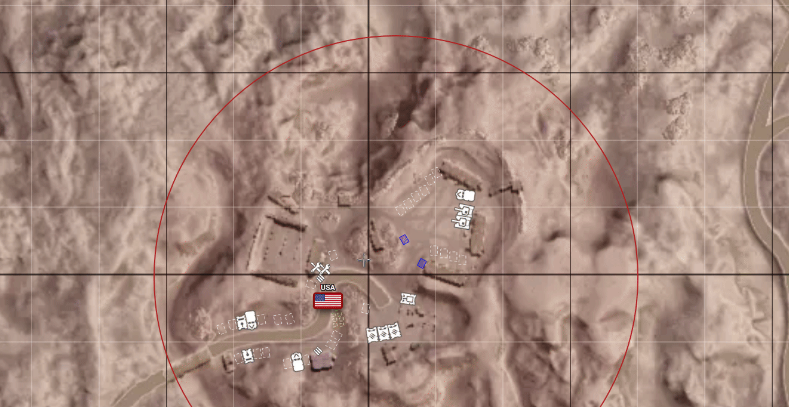</picture>
  
 

 

## 3D Mode

  
<b>Fly over every map in 3D</b>

   

  Browse every vanilla map in 3D and see the terrain, buildings, vegetation and layer info while flying around in camera mode.  
  Open the 3D view with the 3D button in the map menu, or right-click anywhere on the map to start flying from that exact spot.

  

    <picture>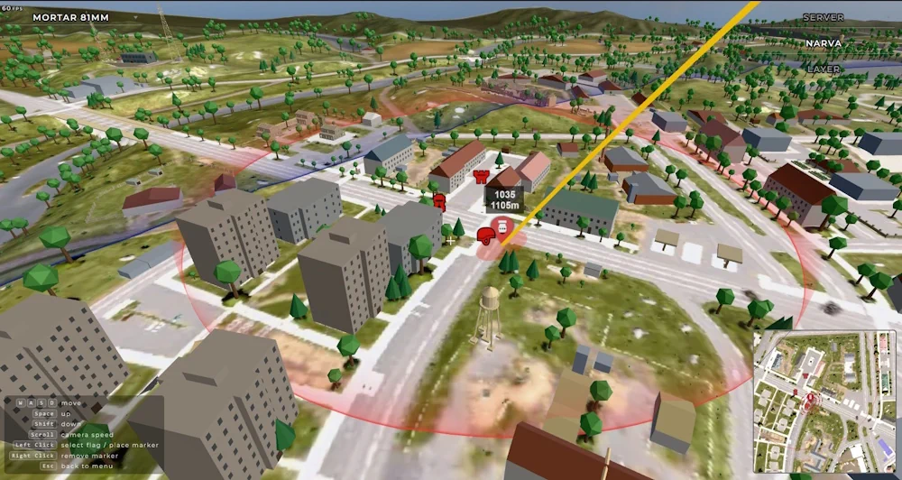</picture>
  
 

  * **Desktop**: move with `WASD` / `ZQSD` / arrow keys, `Space` to go up, `Shift` to go down, mouse wheel to change speed, `Esc` to pause
  * **Mobile**: drag to orbit, pinch to zoom
  * Switch between the Base, Terrain and Topographic textures

  
<b>See your shots in 3D</b>

   

  Click "See in 3D" on any target to watch the projectile path from your weapon to the target and check if terrain is in the way.  
  Weapons, targets, markers, FOB/weapon radiuses and capzones you placed on the 2D map also show up in 3D.

  Left-click while flying to drop an Observation Marker that always shows its distance from the camera.

  
<b>Minimap & Sharing</b>

   

  The 3D view comes with a replica of the 2D map as a minimap: select flags, create markers and targets without ever leaving 3D mode.  

  Share your exact camera position and view angle with a link so your squad sees exactly what you see.

 

## Mods

  
<b>Modded maps, layers, factions and weapons</b>

   

  SquadCalc supports the most popular Squad mods. Enable the ones you play from `Settings > Mods` to add their maps, layers, factions and weapons.  
  You can also sync with modded servers running these mods.

  Galactic Contention, SuperMod, Warzone, Steel Division, Squad Admin Tools, Infinite Warefare

 

## Others

  
<b>Shared Sessions</b>

   

  Start a shared session and invite your friends!  

  Collaborate on a single map, sharing markers, weapons, and targets in real time.
  Synchronize your mortar targets more efficiently, strategize together, and develop tactics seamlessly.

  Sessions work with up to 10 participants.

  

    <picture>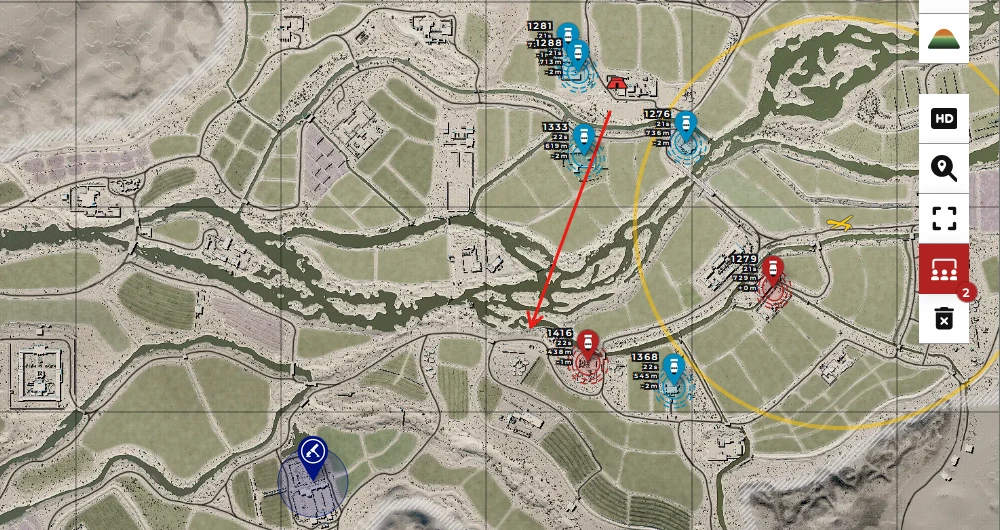</picture>
  

  

  
<b>Advanced Customisation & Information</b>

   

  Want to see spread radius, time of flight, distance AND bearing for each target? You can.  
  Rather have a minimalist, uncluttered map? You can too. Hop in settings to customise everything.

  Get a complete understanding of your shots and visualise a simulation of the projectile path and the terrain between you and your targets. You can even see if terrain is going to block your projectiles when using low angle weapons ! (UB/GRAD) 

  

    <picture>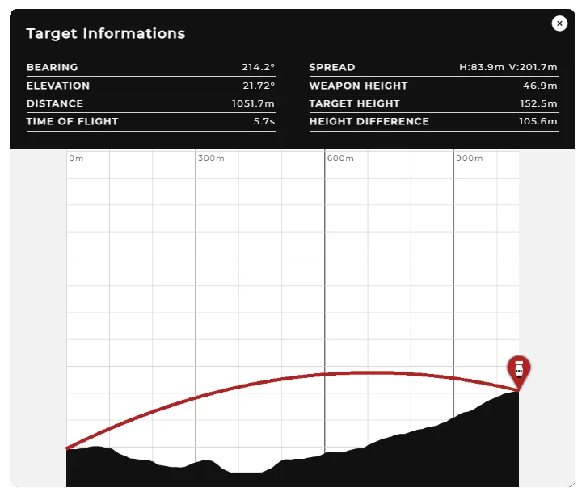</picture>
    <picture>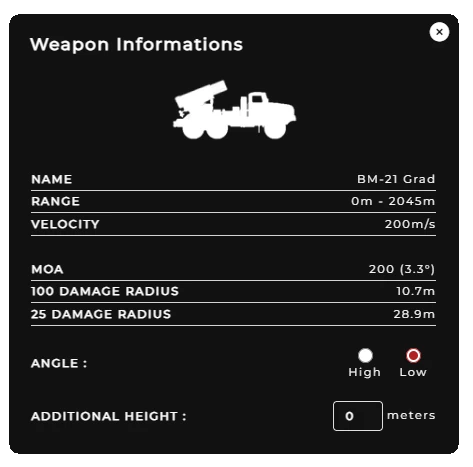</picture>
  

  
<b>Map Layers</b>

   

  

    <picture>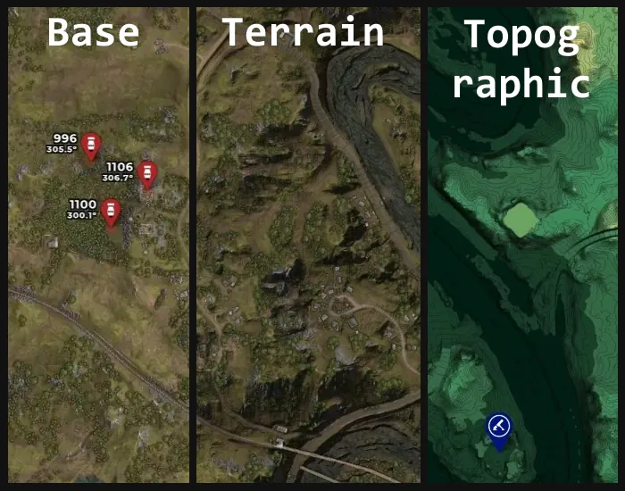</picture>
  

  ### Base map:
  The classic, straight from the game base map.  

  ### Terrain map:
  Base map enhanced with a bump map from the SDK's heightmap, for a better understanding of the terrain.  
  Also known as *"why the fuck is it not the default ingame map?"*

  ### Topographic map:
  A mix of bump map and contour lines with a touch of hypsometric colors for a complete understanding of map relief.

  
<b>Ultra HD Maps</b>

   

  

    <picture>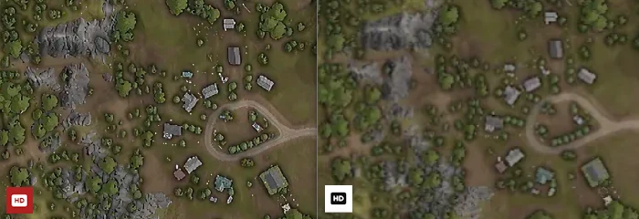</picture>
    
UHD Maps vs regular ingame map image

  

   

  With a single click, you can switch the map to a high-definition version powered by AI upscaling. The HD maps are 8192×8192 resolution images, letting you explore every part of the map in ultra-sharp detail right within the Leaflet interface.

  
<b>Server Syncing</b>

   

   

  

    <picture>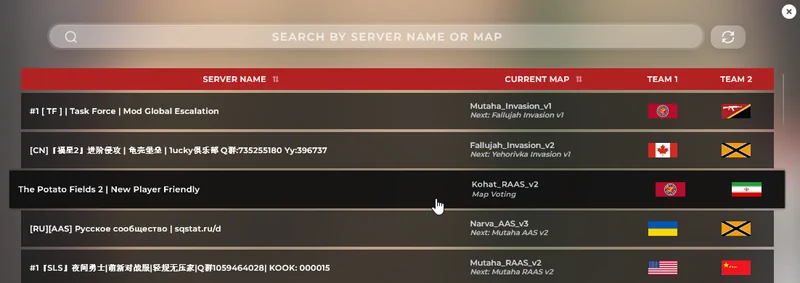</picture>
  

   

  Browse the active servers and click the one you're playing on. SquadCalc will automatically update and load the factions and units for the server’s current map. It will even update automatically if it detects a map change!

  
<b>Import/Export Your Maps</b>

   

   

  

    <picture>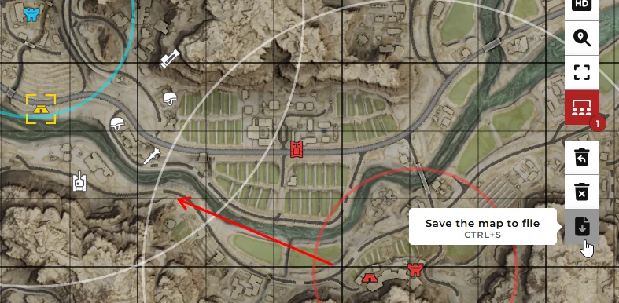</picture>
  

   

  Easily export your map and markers to an offline file for backup or sharing. To restore them later, just drag and drop the file into SquadCalc and your markers will be loaded instantly. These files are also perfect for sharing with teammates to ensure everyone’s on the same page.

   
# **Attributions**
 

🗺️ Map System built on **[Leaflet JS](https://leafletjs.com/)**  
🖼️ Map Images, Marker Icons are from SquadSDK by **[OffWorld Industries](https://www.offworldindustries.com/)**  
🧮 Layers & Factions Data are extracted thanks to **[SquadPipeline](https://github.com/yobaNGE/squad-map-data-CUE4Parse)**  *(a huge thanks to [yobaNGE](https://github.com/yobaNGE) for this amazing tool)*  
🖥️ Servers data provided by **[BattleMetrics](https://www.battlemetrics.com)**  
🗣️ AI Text-To-Speech made with **[Luvvoice](https://luvvoice.com/)**  
🔣 Icons by **[FontAwesome](https://fontawesome.com/icons)**  
⛰️ heightmaps extracted with **[SquadHeight](https://github.com/Metroseksuaali/SquadHeight)** by [Metroseksuaali](https://github.com/Metroseksuaali)  

👌🏼 Thanks to everyone supporting the project with kind words, clever suggestions, and better code than mine

   
# **Contributors**
 

* [Antiaris74](https://github.com/Antiaris74)  
* [d503-ai](https://github.com/d503-ai)  
* [Devil4ngle](https://github.com/Devil4ngle)
* [f0xcb](https://github.com/f0xcb) 
* [Ferrariic](https://github.com/Ferrariic)
* [Guducat](https://github.com/Guducat)
* [Hans-Vader](https://github.com/Hans-Vader) 
* [Metroseksuaali](https://github.com/Metroseksuaali)  
* [TheMatheusDev](https://github.com/TheMatheusDev)  
* [SphaeroX](https://github.com/SphaeroX)  
* sitroz
* [yobaNGE](https://github.com/yobaNGE)  

   
# **Support the project**
 

  

